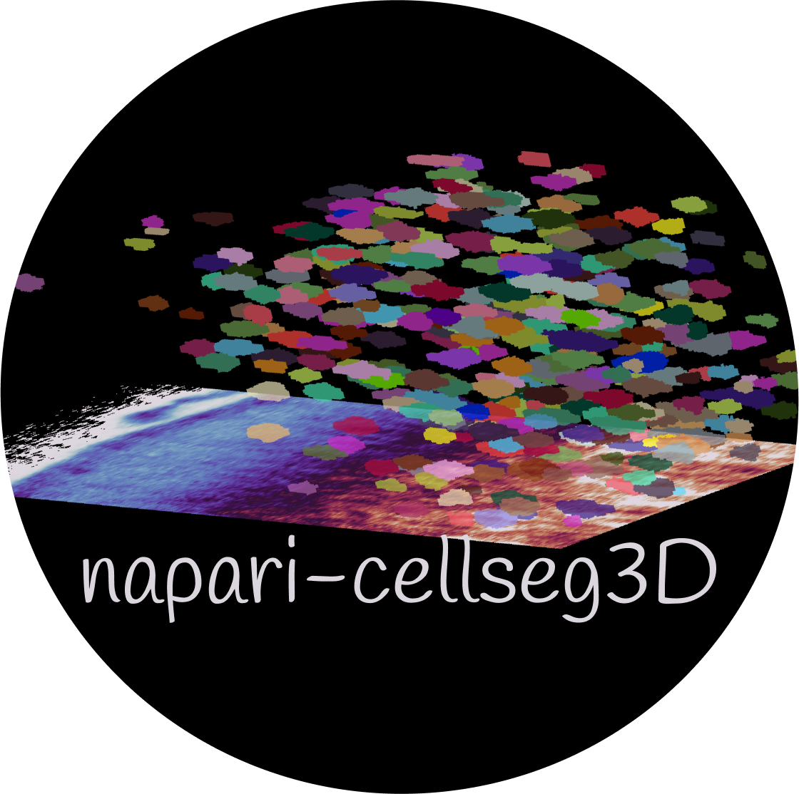

# CellSeg3D API Reference

{ .cs-hero-logo width="280" }

Reference for the `napari_cellseg3d` Python package, generated from its docstrings.

To run inference or training from Python, start with the [High-level API](high-level/index.md).

For installation and usage of the napari plugin, see the [main user documentation](https://adaptivemotorcontrollab.github.io/CellSeg3D/).
